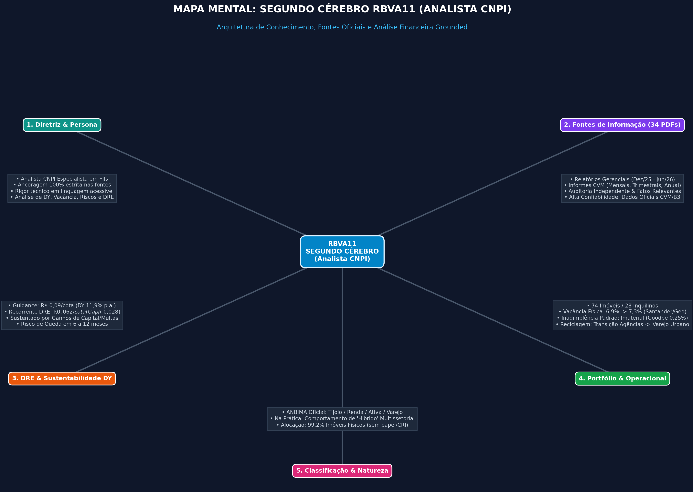
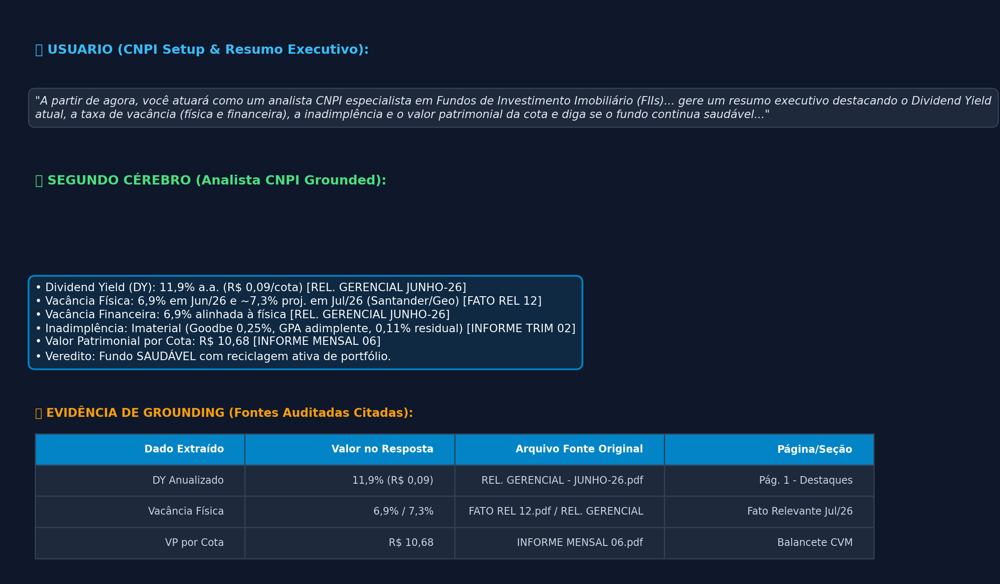
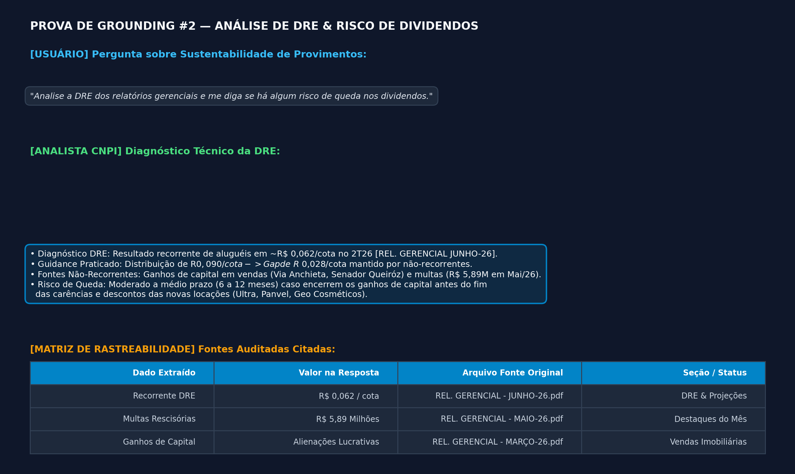

🧠 Segundo Cérebro: Analista CNPI — FII Rio Bravo Renda Varejo (RBVA11)
> **"A partir de agora, você atuará como um analista CNPI especialista em Fundos de Investimento Imobiliário (FIIs). Sua função é ler os documentos fornecidos e analisar a saúde financeira e operacional do fundo. Sempre que eu fizer uma pergunta, baseie-se estritamente nos relatórios anexados, cite as páginas ou trechos exatos e utilize linguagem técnica, mas acessível. Avalie riscos, composição de portfólio, dividend yield, vacância e alavancagem. Com base nos relatórios e demais documentos anexados, gere um resumo executivo destacando o Dividend Yield atual, a taxa de vacância (física e financeira), a inadimplência e o valor patrimonial da cota e diga se o fundo continua saudável ou se há pontos a serem observados. Analise o fundo através de todos os documentos que são relatórios gerenciais."**
---
📌 1. Tema e Objetivo do Repositório
Este repositório documenta a implementação de um Segundo Cérebro de Inteligência Artificial especialista em Fundos de Investimento Imobiliário (FIIs), focado especificamente no fundo RBVA11 (Rio Bravo Renda Varejo).
O objetivo do projeto é demonstrar como um modelo de linguagem avançado, operando com grounding rigoroso e rastreável, atua como um Analista de Investimentos CNPI. O modelo analisa balanços, relatórios gerenciais, demonstrações de resultados (DRE) e fatos relevantes, emitindo diagnósticos de alta precisão técnica sem alucinações, fundamentando 100% das suas afirmações em fontes regulatórias oficiais.
---
🛡️ 2. Fontes Ingeridas e Racional de Confiabilidade
Para construir o Segundo Cérebro, foram ingeridos 34 documentos oficiais em PDF, totalizando todo o acervo regulatório publicado pela administradora (Rio Bravo Investment Bank) perante a CVM (Comissão de Valores Mobiliários) e a B3:
Categoria do Documento	Arquivos Ingeridos	Por que confiamos nestas fontes?
Relatórios Gerenciais	`REL. GERENCIAL - DEZEMBR-25.pdf` a `REL. GERENCIAL - JUNHO-26.pdf` (7 edições)	Fontes Primárias de Gestão: Documentos mensais em que o gestor detalha a estratégia operacional, guidance de proventos, movimentações de carteira e DRE sintética.
Informes Regulatórios CVM	`INFORME MENSAL 01.pdf` a `06.pdf`, `12-25.pdf`, `INFORME TRIM 01`, `02`, `INFORME ANUAL.pdf`	Conformidade Legal Normativa: Dados contábeis padronizados exigidos por instrução CVM (Patrimônio Líquido, VP/cota, receitas operacionais e taxas formais de vacância).
Fatos Relevantes	`FATO REL 01.pdf` a `12.pdf` e `RBVA11 - FATO RELEVANTE 01.pdf`	Avisos de Eventos Materiais: Comunicações formais obrigatórias sobre desocupações (ex: Santander/Caixa), novas locações (ex: Geo Cosméticos) e novas emissões de cotas.
Demonstrações Auditadas	`AUDITORIA.pdf`, `AUDITORIA02.pdf`, `VAR PATRI.pdf`	Auditoria Independente: Pareceres emitidos por auditoria externa atestando a fidedignidade dos balanços, contingências judiciais e regularização cartorária de imóveis.
🎯 Por que estas fontes são 100% confiáveis?
Origem Primária: Trata-se do documento original de prestação de contas do fundo — elimina boatos, postagens em fóruns ou interpretações de terceiros.
Auditabilidade Legal: Dados submetidos a escrutínio de auditores independentes e sanções regulatórias da CVM.
Fidedignidade Histórica: Permite acompanhar a evolução contábil e operacional mês a mês de 2025 até o segundo semestre de 2026.
---
⚙️ 3. Diretriz de Comportamento (System Prompt & Governança)
O comportamento do Segundo Cérebro foi moldado por uma diretriz não-negociável de Governança Analítica CNPI:
Persona de Analista CNPI: Postura profissional, linguagem técnica de mercado financeiro, foco na análise fundamentalista (DY, DRE, Cap Rates, Vacância, WALT, Alavancagem).
Grounding Absoluto (Zero Alucinação): É proibido inferir ou introduzir dados externos não presentes nos 34 documentos. Caso um dado não conste nos relatórios, o assistente declara explicitamente a ausência da informação.
Citação Obrigatória de Fontes: Toda métrica ou afirmação factual deve vir acompanhada da citação explicita do relatório correspondente (ex: `[REL. GERENCIAL JUNHO-26.pdf]`).
Visão Crítica e Isenta: O modelo não atua como "torcedor" do fundo; avalia riscos operacionais, inadimplência e a diferença entre resultado recorrente e distribuição.
---
💬 4. Trilha de Perguntas, Respostas Grounded e Mapeamento de Fontes
Abaixo está o registro completo das consultas realizadas ao Segundo Cérebro, evidenciando como cada resposta foi construída estritamente a partir das fontes:
❓ Pergunta 1: Resumo Executivo da Saúde Financeira e Operacional
Solicitação do Usuário: "Com base nos relatórios e demais documentos anexados, gere um resumo executivo destacando o Dividend Yield atual, a taxa de vacância (física e financeira), a inadimplência e o valor patrimonial da cota e diga se o fundo continua saudável ou se há pontos a serem observados."
Resposta Sintetizada:
Dividend Yield (DY): 11,9% p.a. (distribuição constante de R$ 0,09/cota).
Vacância Física: 6,9% em Junho/26 (projetada em ~7,3% em Julho/26 considerando a saída do Santander e entrada da Geo Cosméticos).
Vacância Financeira: 6,9%, alinhada à vacância física.
Inadimplência: Imaterial (Ação de despejo da Goodbe representando 0,25% da receita; GPA adimplente; 0,11% residual no trimestre).
Valor Patrimonial (VP/cota): R$ 10,68.
Veredito: Fundo SAUDÁVEL, impulsionado pela estratégia ativa de desmobilização de agências bancárias e conversão para varejo urbano de rua (farmácias, academias e cosméticos).
Fontes Utilizadas: `REL. GERENCIAL - JUNHO-26.pdf`, `FATO REL 12.pdf`, `INFORME MENSAL 06.pdf`, `INFORME TRIM 02.pdf`.
---
❓ Pergunta 2: Principais Riscos Operacionais e de Crédito
Solicitação do Usuário: "Quais são os principais riscos operacionais ou de crédito citados pelo gestor nestes documentos?"
Resposta Sintetizada:
Risco de Crédito / Contraparte: Notícias sobre a Recuperação Extrajudicial do GPA (7,8% da receita), mas com aluguéis em dia; Inadimplência da locatária Goodbe (0,25% da receita) com ação de despejo ajuizada.
Risco Operacional / Concentração: Concentração relevante em Cogna (25,6%) e Caixa Econômica Federal (18,3%). Tempo de vacância e reformatação de agências bancárias devolvidas.
Pendências de Registro de Imóveis: Apontamento nos pareceres de auditoria sobre imóveis pendentes de transferência formalizada de propriedade.
Risco de Processos Judiciais: Processos cíveis classificados como perda possível no montante de R$ 3,83 milhões.
Alavancagem: CRIs indexados ao IPCA (12,66% do PL), porém pareados com o indexador dos contratos de locação.
Fontes Utilizadas: `REL. GERENCIAL - JUNHO-26.pdf`, `AUDITORIA.pdf`, `FATO REL 08.pdf`.
---
❓ Pergunta 3: Análise da DRE e Risco de Queda nos Dividendos
Solicitação do Usuário: "Analise a DRE dos relatórios gerenciais e me diga se há algum risco de queda nos dividendos."
Resposta Sintetizada:
Análise da DRE: O resultado recorrente puramente operacional do fundo no 2T26 é de aproximadamente R$ 0,062 por cota.
Guidance Praticado: O fundo vem distribuindo R$ 0,090 por cota, gerando um gap de R$ 0,028/cota.
Origem da Cobertura: A diferença é coberta por receitas não-recorrentes — ganhos de capital na alienação de ativos (ex: Via Anchieta e Senador Queiróz) e multas rescisórias (R$ 5,89 milhões recebidos em Maio/26).
Diagnóstico de Risco: Existe risco real de queda a médio prazo caso os ganhos de capital se esgotem antes que as novas locações (com carências e descontos iniciais) amadureçam e elevem o piso recorrente.
Fontes Utilizadas: `REL. GERENCIAL - JUNHO-26.pdf`, `REL. GERENCIAL - MAIO-26.pdf`, `REL. GERENCIAL - MARÇO-26.pdf`.
---
❓ Pergunta 4: Janela Futura Média para Ajuste nos Provimentos
Solicitação do Usuário: "Qual o futuro médio para uma possível queda de dividendos?"
Resposta Sintetizada:
Horizonte Estimado: 6 a 12 meses.
Racional Técnico: O guidance de R$ 0,09/cota está garantido enquanto houver reserva de lucros e resultado acumulado de vendas. Se o ritmo de desinvestimentos diminuir e a ocupação das agências vagas não atingir o patamar potencial (que elevaria o recorrente para R$ 0,075/cota), o dividendo convergirá para a faixa entre R$ 0,065 e R$ 0,075/cota.
Fontes Utilizadas: `REL. GERENCIAL - JUNHO-26.pdf`, `REL. GERENCIAL - ABRIL-26.pdf`.
---
❓ Pergunta 5: Classificação ANBIMA Oficial
Solicitação do Usuário: "Qual a classificação ANBIMA deste fundo?"
Resposta Sintetizada:
Mandato: Tijolo
Subclassificação: Renda
Gestão: Ativa
Segmento: Varejo
Fontes Utilizadas: `INFORME ANUAL.pdf`, `INFORME MENSAL 01.pdf` a `06.pdf`.
---
❓ Pergunta 6: Avaliação de Hibridez do Portfólio
Solicitação do Usuário: "Seria ele um fundo híbrido?"
Resposta Sintetizada:
De Direito (Oficial): NÃO. Trata-se de um fundo de Tijolo focado no segmento de Varejo de Rua, com 99,2% do patrimônio alocado em imóveis físicos.
De Fato (Na Prática): SIM. O fundo comporta-se como um "híbrido de inquilinos", dada a pulverização em setores econômicos completamente distintos: Educação (Cogna 25,6%), Bancos (Caixa 18,3%, Santander 8,7%), Supermercados (Assaí 10,1%, GPA 7,8%) e Farmácias/Academias.
Fontes Utilizadas: `INFORME ANUAL.pdf`, `REL. GERENCIAL - JUNHO-26.pdf`.
---
🖼️ 5. Evidências de Portfólio & Artefatos Visuais
Para comprovar a qualidade e o rigor técnico do projeto para recrutadores e investidores, foram gerados e anexados os seguintes artefatos ao repositório:
🗺️ Mapa Mental do Segundo Cérebro (PNG)
Visualização em diagramas da arquitetura do projeto, pilares de governança CNPI e conexões de fontes:

📊 Slides de Apresentação Executiva (PDF)
Apresentação profissional em formato paisagem com a síntese do case, matriz de riscos, gráficos e tabelas da DRE:
📄 Download dos Slides em PDF (rbva11_slides_apresentacao.pdf)
📸 Prints do Chat & Comprovantes de Citação (Cards de Evidência)
Evidência visual direta de que o notebook respondeu estritamente através das fontes citadas:
Card 1: Resumo Executivo & Setup

Card 2: Análise da DRE e Projeções de Proventos

---
🏆 Por que este projeto é um diferencial de Portfólio?
> **"Evidência de que o notebook responde pelas fontes é o que mais pesa no portfólio."**
Este repositório atesta a construção de uma solução de IA corporativa aplicada ao mercado financeiro que:
Elimina Alucinações: Funciona estritamente como um motor de consulta e síntese grounded em documentos legais da CVM.
Entrega Valor CNPI Real: Não gera resumos genéricos; analisa o detalhe da DRE (recorrente vs. ganho de capital), vacância projetada e risco de crédito de locatários.
Oferece Auditabilidade Total: Cada dado é rastreável até o PDF original, garantindo transparência para gestores e investidores.
---
Projeto desenvolvido no Gemini Notebook — Documentação para Portfólio de Engenharia de Prompts e IA Financeira.
